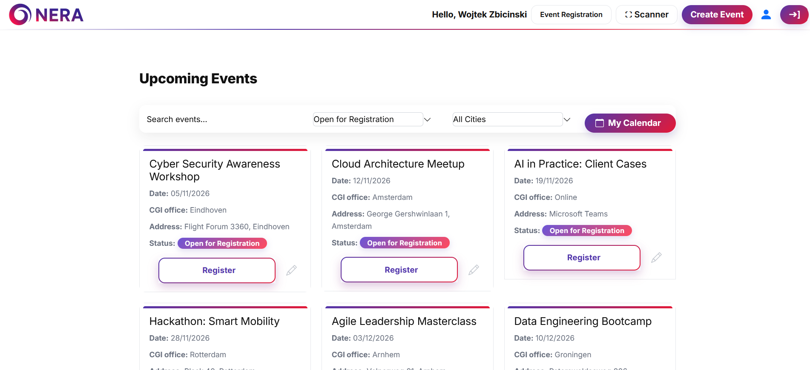
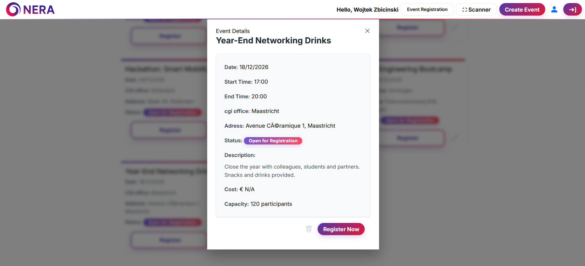
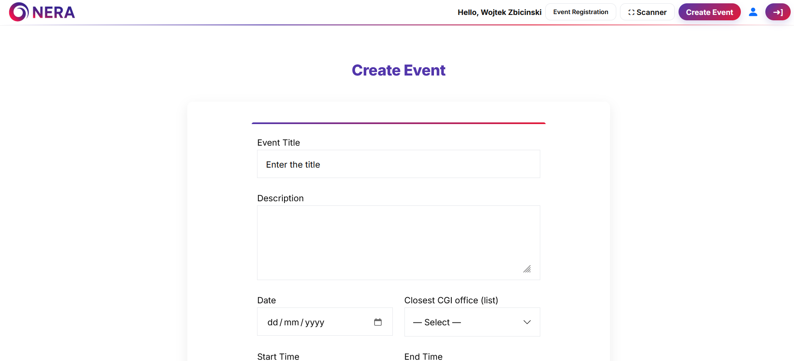
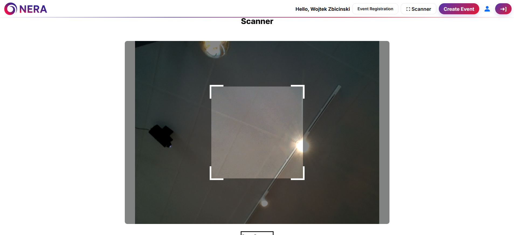
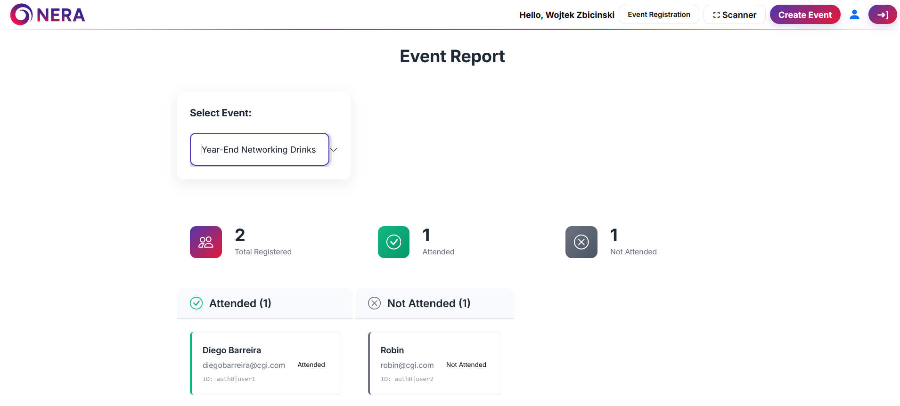

# NERA Event Manager

[Nederlands](#nederlands) | [English](#english)

---

## Nederlands

NERA is een webapplicatie voor het organiseren en beheren van bedrijfsevenementen, gebouwd als groepsproject bij Fontys Hogescholen met CGI als opdrachtgever. Medewerkers kunnen evenementen bij de verschillende CGI-kantoren bekijken, zich met één klik aanmelden en bij de deur inchecken met een persoonlijke QR-code. Organisatoren kunnen evenementen aanmaken, deelnemers scannen en zien wie er echt is geweest.

### Screenshots

| Overzicht evenementen | Details evenement |
|---|---|
|  |  |

| Evenement aanmaken | QR-scanner | Aanwezigheidsrapport |
|---|---|---|
|  |  |  |

### Functionaliteiten

**Voor medewerkers**
- Aankomende evenementen bekijken, zoeken op naam en filteren op status en CGI-kantoor
- Veilig inloggen via Auth0
- Met één klik aanmelden voor een evenement
- Een bevestigingsmail ontvangen met een agenda-uitnodiging (.ics) en een persoonlijke QR-code
- Aangemelde evenementen bekijken in *My Calendar* en je QR-code altijd terugvinden

**Voor organisatoren (admin)**
- Evenementen aanmaken, bewerken en verwijderen (datum, tijd, kantoor, adres, kosten, capaciteit, beschrijving)
- Aanmelden voor een evenement openen of sluiten
- QR-codes van deelnemers scannen met de camera van een telefoon of laptop om ze in te checken
- Per evenement een aanwezigheidsrapport bekijken: wie er was en wie niet

### Technologie

| Laag | Technologie |
|---|---|
| Frontend | ASP.NET Core Razor Pages, Shoelace web components, Bootstrap |
| Backend | ASP.NET Core 8 (C#) |
| Database | SQL Server met Entity Framework Core 8 |
| Authenticatie | Auth0 (OpenID Connect) |
| E-mail | MailKit / MimeKit via SMTP |
| QR-codes | QRCoder (genereren), html5-qrcode (scannen) |

### Architectuur

De solution is opgebouwd in lagen:

```
NERA/
├── Domain/             Entiteiten, enums en interfaces
├── NERA Data/          EF Core DbContext, configuraties, migraties, repositories
├── NERA Logic/         Businesslogica: aanmelden, QR-codes, e-mail, agenda-uitnodigingen
└── NERA Presentation/  Razor Pages-webapp (UI en opstarten)
```

De database bestaat uit twee tabellen: `Event` en `EventRegistration`. Gebruikersaccounts worden beheerd door Auth0, dus bij een aanmelding wordt alleen het Auth0-ID van de gebruiker opgeslagen.

---

## English

NERA is a web application for organising and managing company events, built as a group project at Fontys University of Applied Sciences with CGI as the client. Employees can browse events at the different CGI offices, sign up with one click and check in at the door with a personal QR code. Organisers can create events, scan attendees and see who actually showed up.

### Screenshots

| Event overview | Event details |
|---|---|
|  |  |

| Create event | QR scanner | Attendance report |
|---|---|---|
|  |  |  |

### Features

**For employees**
- Browse upcoming events, search by name and filter by status and CGI office
- Log in securely with Auth0
- Register for an event with one click
- Receive a confirmation email with a calendar invite (.ics) and a personal QR code
- See your registered events in *My Calendar* and view your QR code at any time

**For organisers (admin)**
- Create, edit and delete events (date, time, office, address, cost, capacity, description)
- Open or close events for registration
- Scan attendees' QR codes with a phone or laptop camera to check them in
- View an attendance report per event: who attended and who didn't

### Tech stack

| Layer | Technology |
|---|---|
| Frontend | ASP.NET Core Razor Pages, Shoelace web components, Bootstrap |
| Backend | ASP.NET Core 8 (C#) |
| Database | SQL Server with Entity Framework Core 8 |
| Authentication | Auth0 (OpenID Connect) |
| Email | MailKit / MimeKit over SMTP |
| QR codes | QRCoder (generating), html5-qrcode (scanning) |

### Architecture

The solution follows a layered architecture:

```
NERA/
├── Domain/             Entities, enums and interfaces
├── NERA Data/          EF Core DbContext, configurations, migrations, repositories
├── NERA Logic/         Business logic: registration, QR codes, email, calendar invites
└── NERA Presentation/  Razor Pages web app (UI and startup)
```

The database has two tables: `Event` and `EventRegistration`. User accounts are managed by Auth0, so registrations only store the user's Auth0 ID.
